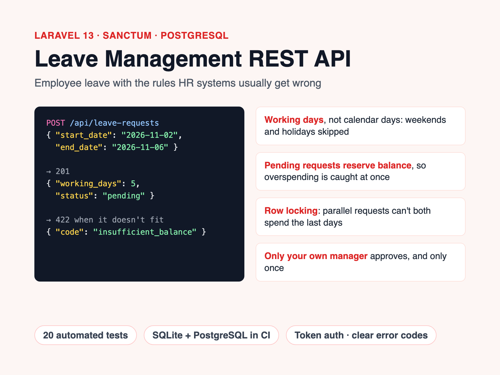

# Leave Management API (Laravel)

[](https://github.com/dinulimann/leave-management-api/actions/workflows/tests.yml)



A REST API for employee leave: employees request time off, their manager approves or rejects it, and balances are kept per leave type and year. Built with **Laravel 13**, **Sanctum** token auth and **PostgreSQL**, with 20 tests that run against both SQLite and PostgreSQL in CI.

The interesting part is not the CRUD but the rules that HR systems usually get wrong:

- **Working days, not calendar days.** A Monday–Friday request over a public holiday costs 4 days, not 5. Weekend-only requests are refused.
- **Pending requests reserve balance.** With 12 days and 10 already pending, a 3-day request is refused at submission, not discovered later at approval.
- **No double booking.** Overlapping pending/approved requests for the same employee are refused.
- **Safe under concurrency.** Submission locks the employee row and approval locks the balance row (`SELECT … FOR UPDATE`), so two parallel requests can't both spend the last days.
- **Only your own manager decides,** never yourself, and only once. A request that's already approved can't be approved or rejected again.
- **Cancelling approved leave refunds the days,** but only before the leave starts.
- **Per-type rules:** sick leave may be back-dated, annual leave may not; unpaid leave keeps no balance at all.
- **One request, one year.** Leave crossing 31 December must be split, so each year's balance stays correct.

Rule violations return `422` with a machine-readable code:

```json
{ "message": "This request needs 3 working day(s) but only 2 are available.", "code": "insufficient_balance" }
```

## Endpoints

All endpoints except `login` need `Authorization: Bearer <token>`.

| Method | Path | Who | Description |
|---|---|---|---|
| POST | `/api/login` | anyone | Email + password → API token (rate limited) |
| POST | `/api/logout` | user | Revoke the current token |
| GET | `/api/me` | user | Profile, role and manager |
| GET | `/api/leave-types` | user | Leave types and yearly quotas |
| GET | `/api/leave-balances?year=2026` | user | Entitled / used / pending / available per type |
| GET | `/api/holidays?year=2026` | user | Public holidays used in the calculation |
| GET | `/api/leave-requests?status=pending` | user | Your own requests |
| POST | `/api/leave-requests` | user | Submit a request |
| GET | `/api/leave-requests/{id}` | owner or their manager | One request |
| POST | `/api/leave-requests/{id}/cancel` | owner | Cancel (refunds approved days) |
| GET | `/api/team/leave-requests?status=pending` | manager | Requests from direct reports, pending first |
| POST | `/api/leave-requests/{id}/approve` | their manager | Approve, with optional `note` |
| POST | `/api/leave-requests/{id}/reject` | their manager | Reject, with optional `note` |

## Quick start

Requires PHP 8.3+, Composer and Docker.

```bash
composer install
cp .env.example .env && php artisan key:generate
docker compose up -d                    # PostgreSQL on localhost:5549
php artisan migrate --seed              # demo users, leave types, holidays
php artisan serve
```

Demo accounts (password `password`): `manager@example.com` manages `employee@example.com` and `budi@example.com`.

```bash
API=http://localhost:8000/api
TOKEN=$(curl -s $API/login -H 'Accept: application/json' \
  -d email=employee@example.com -d password=password | jq -r .token)

curl -s $API/leave-requests -H 'Accept: application/json' -H "Authorization: Bearer $TOKEN" \
  -d leave_type_id=1 -d start_date=2026-11-02 -d end_date=2026-11-06 -d reason="Family trip"
# → "working_days": 5, "status": "pending"
```

The seeded holidays are fixed-date examples only. Load your country's official calendar into the `holidays` table before real use.

## Tests

```bash
php artisan test                        # SQLite in memory
DB_CONNECTION=pgsql DB_HOST=127.0.0.1 DB_PORT=5549 DB_DATABASE=leave \
  DB_USERNAME=leave DB_PASSWORD=leave php artisan test   # against PostgreSQL
```

CI runs both, plus `pint --test` for code style. The feature tests pin "today" to a fixed date, so date rules are deterministic.

## Code tour

```
app/Services/LeaveService.php          submit / approve / reject / cancel, with transactions and row locks
app/Services/WorkingDayCalculator.php  weekdays minus public holidays
app/Policies/LeaveRequestPolicy.php    who may view, cancel and decide
app/Exceptions/LeaveRuleViolation.php  422 + error code for broken rules
app/Http/Controllers/                  thin controllers, form requests, API resources
tests/Feature/LeaveFlowTest.php        the rules above, end to end through HTTP
```

## Tech

PHP 8.4 · Laravel 13 · Sanctum · PostgreSQL 16 · PHPUnit · Pint · GitHub Actions · Docker
